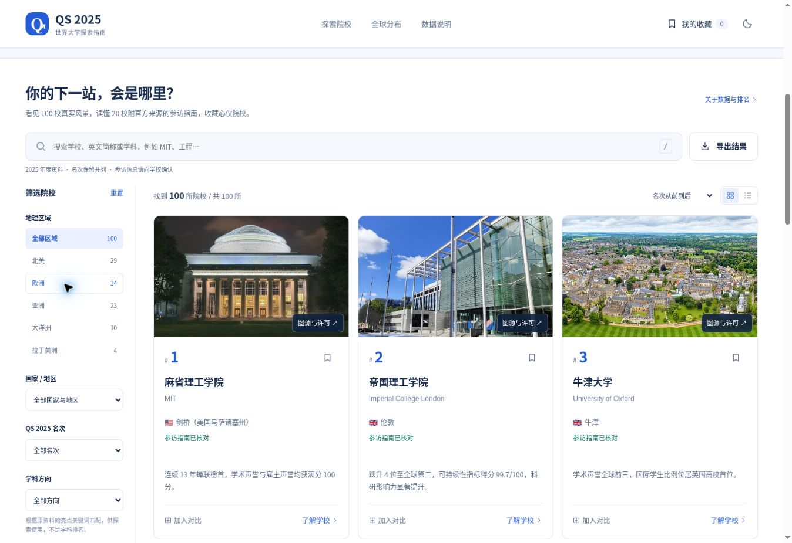

# QS 2025 世界大学探索指南

一个可离线使用的大学探索与校园参访网站。原生 HTML、CSS、JavaScript，无运行时 CDN、无框架、无 npm 依赖。保留 QS 2025 年度口径，不把历史排名当作最新榜单。



截图中三张校园照片的作者依次为 Fcb981（Thermos 编辑）、Shadowssettle、Chensiyuan；原图及对应许可见 [完整照片署名表](IMAGE_CREDITS.md)。截图中的图像改编按 [CC BY-SA 4.0](https://creativecommons.org/licenses/by-sa/4.0/) 提供，原图署名与许可说明继续适用。

## 当前版本

100 所学校都有真实校园封面，共 140 张本地 WebP 照片。前 20 所各有 3 张照片及重新整理的参访指南：城市、对应校区、官网、概览、3 处校园看点、预约、费用查询、开放范围、公共交通、地址地图和官方来源，标注核对日期。照片可以放大和切换，逐张查看作者、图示校区、原图与许可。

手机采用单列图片卡片、可折叠筛选、16px 详情正文。保留地图、中英文检索、区域 / 国家 / 名次 / 学科关键词组合筛选、排序、分页、紧凑视图、深浅色主题、本地收藏、最多 4 校对比、可分享 URL 和 CSV 导出。

在线先读取约 79KB 的轻量目录，再按需加载单校详情；图片延迟加载。完整内置数据只在本地文件模式或请求失败时读取，避免正常访问重复加载全部长文。图片损坏时显示占位，不影响文字；详情失败有独立重试，地图失败仍能筛选。

## 运行与开发

直接双击根目录 `index.html` 即可离线阅读，所有照片和脚本都在仓库中。收藏与主题存放在本机浏览器。本地 `file://` 链接只对本机有效。

也可在项目根目录启动静态服务：

```bash
python3 -m http.server 3000
```

访问 `http://localhost:3000`；部署后的 URL 可保留筛选、分页、学校详情与对比名单。开发需要 Node.js 18 以上，不用执行 `npm install`：

```bash
npm run data   # 更新所有 JSON、逐校详情、离线脚本和图片署名表
npm run check  # 语法与 43 项测试
npm run build  # 导出完整静态站点到 dist/
```

GitHub Actions 在 Node 22 / 24 上检查并构建。GitHub Pages 可从根目录部署；`dist/` 适用于其他静态托管。实测范围见 [验证记录](docs/VALIDATION.md)。

## 资料依据与边界

名次依据 [QS 2025 官方页面](https://www.topuniversities.com/world-university-rankings/2025) 和 [QS 发布表格（UTM 保存）](https://sps.utm.my/wp-content/uploads/2024/09/2025-QS-World-University-Rankings-2.2-For-qs.com_.pdf)，已修正 14 条并列名次。原 Markdown 的行序号不能替代实际名次；`sourceIndex` 保留行序，`qs2025-048` 等编号独立、稳定，收藏和旧分享链接继续使用。

20 校的“已核对”只涵盖结构化概览、校区、参访入口与限制、交通建议，并非全校历史与学科断言的背书。每条指南附官方来源与核对日期（2026-11-06）；实际开放和预约随学校公告变化。招生导览、一般校园访问与博物馆票务分别说明。部分官网会拒绝自动请求，相关条目结合可读取的官方页面及官方网页的搜索索引核对。

已纠正原资料把霍金列为诺贝尔奖得主、混用 IP Paris 与 École Polytechnique，以及港科大到达路线的错误；为东京工业大学和原阿德莱德大学补充合并现状，同时保留历史榜单名称。修正依据在 [content-updates.json](data/content-updates.json)。其余历史、学科亮点和参访长文沿用 [原始 Markdown](QS2025%20top100.md)，未逐项独立核实，页面单独标明。仓库原有 PDF 是历史存档，不随本站资料修订自动更新。学科筛选是关键词匹配，不是学科排名或完整专业目录。

## 照片与许可

全部为从 Wikimedia Commons 取得的真实照片，未使用 AI 生成的校园图。100 张封面和 40 张补充照片经过联系表检查；多校区或历史建筑在图片说明中标注，不以照片推断当前开放范围。文件缩放、移除元数据并转为 WebP，保留原场景。

[照片署名与许可](IMAGE_CREDITS.md) 列出全部作者、原图、许可与派生文件。图片各自遵循原始 CC BY、CC BY-SA、CC0 或公有领域条件，不适用项目代码的许可；CC BY-SA 派生文件继续采用对应的相同方式共享许可。

选图与元数据的权威输入为 [campus-media.json](data/campus-media.json)，包含校区、图示地点、作者、许可、来源、尺寸、字节数与 SHA-256。`scripts/collect-campus-media.py` 和 `collect-campus-gallery.py` 用于候选检索；`prepare-campus-photos.py` 默认根据已审核清单重新下载和处理（开发环境需 Python + Pillow），`--research-selection` 才使用外部搜索缓存重新选片。重新处理后须核对图像和清单哈希，再运行 `npm run data`；不要仅凭搜索命中自动替换校园图。

## 数据维护

| 文件 | 用途 |
| --- | --- |
| `QS2025 top100.md` | 原始名单、历史与长文资料 |
| `data/rank-corrections.json` | 名次与名称修正 |
| `data/verified-guides.json` | 20 校结构化参访资料及逐条来源 |
| `data/content-updates.json` | 纠错依据与机构变更说明 |
| `data/campus-media.json` / `assets/campuses/` | 140 张照片的元数据及本地文件 |
| `data/catalog.json` / `data/details/` | 在线轻量目录与单校详情，自动生成 |
| `data/universities.json` / `universities.inline.js` | 完整 JSON 与离线回退，自动生成 |
| `js/core.js` / `script.js` | 数据、容错与页面交互 |
| `docs/IMPLEMENTATION.md` | 设计与实现取舍 |

修改输入后统一运行 `npm run data`，不要只改某一个生成文件。新增学校年度数据需要独立的年度排名模型，当前版本尚未加入 2026 / 2027 榜单。

原项目：[anonymous2333333/QS-2025-World-University-Rankings-Top-100-Guide](https://github.com/anonymous2333333/QS-2025-World-University-Rankings-Top-100-Guide)。
